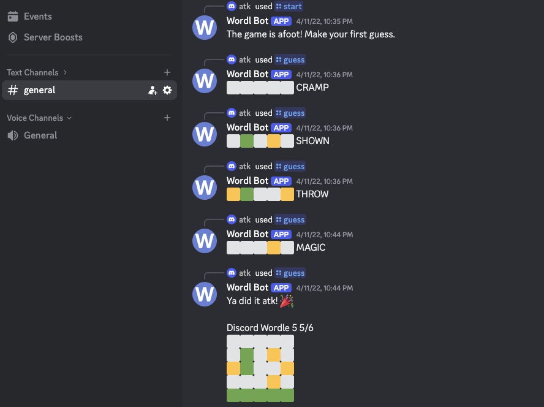

# Wordl Bot

Play wordle on your discord server! Inspired Josh Wardle's puzzle game and other variations of it found on the internet.

## How to use bot

Invite this bot to your server. Link goes [here](https://dsc.gg/wordl)

Use `/` as prefix with these commands:

-   `start` to start a session
-   `guess` to make a guess

The game will start as `wordle` mode by default, the good old-fashioned, one five-lettered word.

## How to setup

-   Git clone this repository
-   Copy `.env.example` to `.env` and fill in the Discord token, client id, Redis and MongoDB credentials
-   Redis connects over TLS (`rediss://`) by default; set `REDIS_TLS=false` for a local, non-TLS Redis
-   `npm install`
-   `node src/deploy-commands.js`
-   And you're ready to go

## How to test

-   Use `npm run test:live` command to run `jest --watchAll` in the background
-   Use `npm run test`command to run the test one time and generate coverage report

## TODO

-   Keep track of winner
-   Check if word is english
-   Put guess evaluation to separate function
-   Isolate test cases

## What to improve

-   Research command format (which format is most preferred)
-   Beta user

## Resources

-   [Discord.js](https://discord.js.org/#/)
-   [Keyv](https://www.npmjs.com/package/keyv)
-   [Nodemon](https://www.npmjs.com/package/nodemon)
-   [Redis](https://redis.io)
